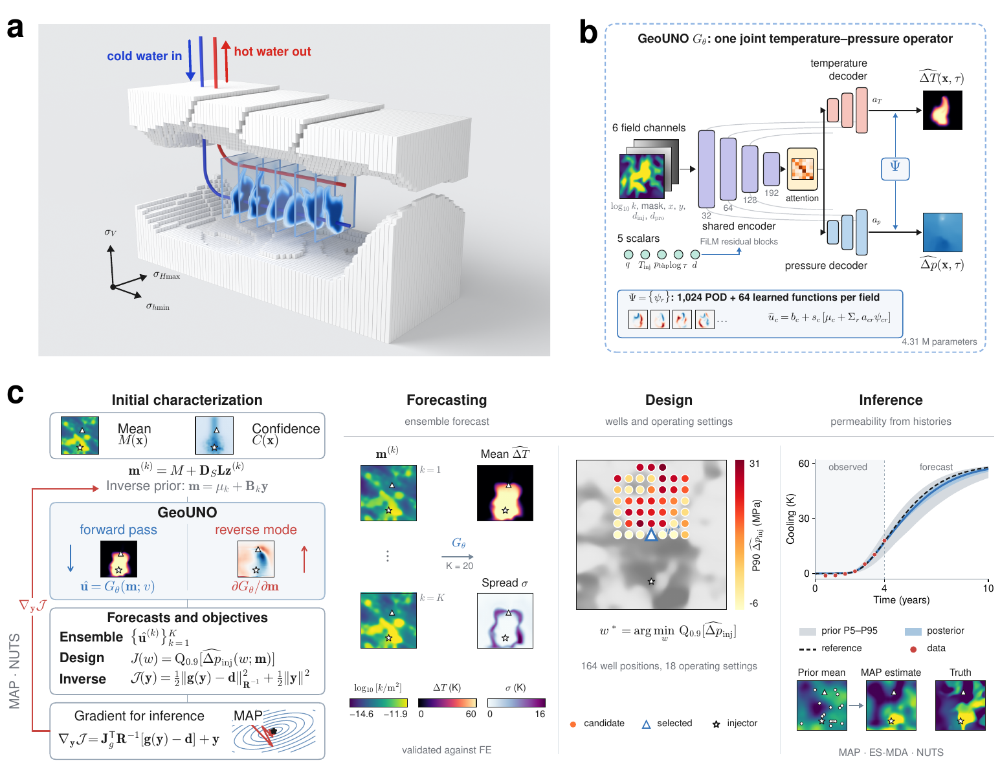
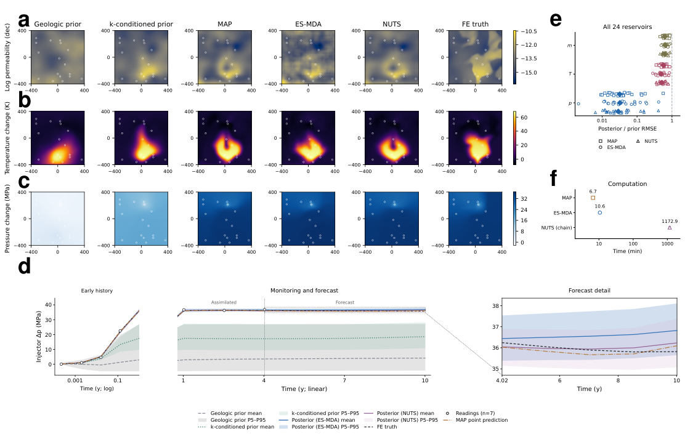

# GeoUNO: joint operator learning for geothermal forecasting and inference under uncertainty

[](LICENSE)
[](docs/DATA.md#licence)
[](pyproject.toml)
[](https://github.com/Yulongggggg/AVF_geothermal/actions/workflows/tests.yml)

GeoUNO is a joint temperature–pressure neural operator for enhanced geothermal systems. It replaces a coupled
thermo-hydro-mechanical (THM) finite-element (FE) simulator in synthetic two-dimensional reservoir sections and is
fast and differentiable enough for ensemble forecasting, MAP / ES-MDA / NUTS permeability inversion and
goal-oriented monitoring design.

This repository is the code and artifact release for

> Yulong Liu, Jonah Botvinick-Greenhouse, Yunan Yang and Chloé Arson.
> *Joint operator learning for geothermal forecasting and inference under uncertainty.* Manuscript, 2026.

It contains the fixed transferred model used for the paper's applications (checkpoint SHA-256 `ed043489…dc18e`), the inference and
monitoring-design code, the 24 test reservoirs used for inversion, the six-reservoir NUTS chains, the frozen
experiment protocols and the Source Data behind the tables. Every scientific function is transcribed statement by
statement from the code that produced the paper results; the model, inference, monitoring and training components
are checked against that code bit for bit on the released data, and the inverse prior is refitted from released
inputs ([docs/PROVENANCE.md](docs/PROVENANCE.md)).

Table 1 uses three independently initialized and refined GeoUNO models; its packaged Source Data now report
their means and sample standard deviations. The [7–8 October code review](docs/REVIEW_20261007.md) records the
geothermal-operator naming correction, installed-package repairs, restart checks and current validation.



## Contents

| Component | Where | Runs from this release? |
|---|---|---|
| GeoUNO architecture (POD1024 + 64 learned coordinate functions per field) | [`geouno/model`](geouno/model) | yes |
| Physical input encoding, dense and block-averaged predictions | [`geouno/inputs.py`](geouno/inputs.py), [`geouno/backend.py`](geouno/backend.py) | yes |
| Static Gaussian conditioning, posterior, MAP, ES-MDA, NUTS, forecast scores | [`geouno/inverse`](geouno/inverse) | yes |
| Monitoring geometries, coordinate-keyed noise, A-optimal design, 49 configurations | [`geouno/monitoring`](geouno/monitoring) | yes |
| Paper tables and abstract numbers from Source Data | [`geouno/paper.py`](geouno/paper.py), [`geouno/resources/source_data`](geouno/resources/source_data) | yes |
| Inverse-prior fit (stationary covariance from 1,024 training fields) | [`geouno/inverse/fit_prior.py`](geouno/inverse/fit_prior.py) | yes |
| POD basis and 132-epoch transfer training | [`geouno/training`](geouno/training), [docs/TRAINING.md](docs/TRAINING.md) | needs the FE corpus |
| Frozen protocols, per-task paper results, original sources | [`protocols`](protocols), [`reference`](reference), [`provenance`](provenance) | — |

## Installation

Python 3.10 or later. The paper environment used Python 3.11, PyTorch 2.8.0, NumPy 2.4.6, SciPy 1.15.3,
Pyro 1.9.1, ArviZ 0.22.0 and iterative-ensemble-smoother 1.1.0 ([`environment.yml`](environment.yml)).

```bash
git clone https://github.com/Yulongggggg/AVF_geothermal.git
cd AVF_geothermal
python -m venv .venv && source .venv/bin/activate
pip install torch==2.8.0 --index-url https://download.pytorch.org/whl/cpu   # or the CUDA wheel
pip install -e ".[all]"
```

`geouno[esmda]` installs Equinor's `iterative-ensemble-smoother`, which is GPL-3.0 licensed; it is only needed
for ES-MDA. `geouno[nuts]` installs Pyro and ArviZ.

## Quick start

The packaged table checks run without downloading model assets:

```bash
geouno paper-numbers         # 80 printed values, including three-seed Table 1 means and SDs
```

**Artifact access (checked 8 October 2026).** Anonymous access to the repository and core download URL
returns HTTP 404. Public download is therefore not yet verified; public access is planned with publication.
Users with a local copy of the release assets can install them with
`geouno download --from-dir /path/to/release-assets`. The following model commands require the core assets.

```bash
geouno download              # model, inverse prior and 25 reservoirs (343 MB), SHA-256 verified
geouno verify                # artifact hashes + posterior value/gradient check against the archived run
geouno predict --case test_01   # forward prediction vs. FE truth at all eleven stored times
geouno paper-numbers         # recompute Tables 1, 2, S1 and the abstract numbers from Source Data
```

```python
import torch
from geouno import artifacts
from geouno.tasks import load_backend

backend = load_backend(device='cpu')                 # checkpoint is hash-checked on load
reservoirs = artifacts.Reservoirs()
case = reservoirs.case('test_01')                    # FE truth, observations, prior mean, ...
base = backend.base_tensor(reservoirs.base('test_01'))
logk = torch.as_tensor(case['logk_truth'])            # log10 permeability (m^2), 128 x 128
with torch.no_grad():
    fields = backend.predict_real(base, 10, logk)    # [1, 2, 160, 128]: Delta T [K], Delta p [MPa] at 10.01 years
```

## Reproducing the paper

| Paper item | Command | Cost |
|---|---|---|
| Table 1, Table 2, Supplementary Table 1, abstract numbers (80 printed values) | `geouno paper-numbers` | seconds |
| One inversion of Table 2 / Figs. 5–6 (e.g. ES-MDA, 17 locations, reservoir 1) | `geouno run --config multiwell_opt17 --case test_01 --method esmda --threads 4` | ≈10 min (paper: 4 CPU threads) |
| Any of the 1,128 registered inversion tasks: 1,104 monitoring evaluations (45 configurations × 24 reservoirs + 4 noise variants × 6) and 24 MAP runs | `geouno run --config <key> --case test_XX --method esmda\|static\|map` | ≈10 min each |
| Prior and statically conditioned reference ensembles | `geouno run --method prior` / `--method static_prior` | minutes |
| Monitoring observation files of every configuration | `geouno prepare-cases --check --out cases/` | minutes |
| NUTS diagnostics and scores (Table 2, Supplementary Tables 10–12) from the released chains | `geouno download --group nuts && geouno nuts-verify` | minutes |
| A NUTS chain from scratch | `geouno nuts-chain --case test_01 --chain 0 --device cuda:0 --out runs/nuts` | ≈3.6 h on one RTX A4000 |
| Inverse prior (marginal SD 0.976 dec) | `geouno download --group prior && geouno refit-prior --out runs/prior` | minutes |
| POD basis and transferred application-model training | [docs/TRAINING.md](docs/TRAINING.md) | FE corpus, 4 GPUs |

Every `geouno run` prints the manuscript metrics next to the archived values of the same task
(`geouno/resources/paper_task_scores.json`). The full list of tasks, seeds and expected agreement is in
[docs/REPRODUCIBILITY.md](docs/REPRODUCIBILITY.md).

**Verification of this release.** All 80 supported printed table and abstract values recompute from Source Data.
The complete 53-check comparison with the archived research code passed on 7 October. Selected task reruns and
NUTS chain checks from 5 October are recorded separately in the
[verification report](docs/REPRODUCIBILITY.md#5-verification-of-this-release). CPU portability remains limited:
six audited pressure summaries exceeded the archived GPU comparison tolerance, with a largest difference of
0.005368 MPa. Agreement with the original implementation does not resolve this hardware-dependent discrepancy.



## Model and data artifacts

The artifact manifest identifies large files under the GitHub release
[`artifacts-v1`](https://github.com/Yulongggggg/AVF_geothermal/releases/tag/artifacts-v1); `geouno download`
fetches and verifies them when that release is accessible (see the access status above). Hashes of every file are in
[`geouno/resources/release_manifest.json`](geouno/resources/release_manifest.json).

| Asset | Group | Size | Content |
|---|---|---|---|
| `geouno_pod1024_ed043489.pt` | core | 177 MiB | selected GeoUNO checkpoint (4,309,756 trainable parameters + fixed POD basis) |
| `prior_factor_64eb46fb.npy` | core | 64 MiB | 4096 × 4096 factor of the training-fitted inverse prior |
| `reservoirs_v1.tar` | core | 86 MiB | the paper's case files and base inputs of 24 test reservoirs and 1 validation pilot |
| `nuts_test_0{1..6}_v1.tar`, `nuts_summary_v1.tar` | nuts | 1.0 GiB | 6 reservoirs × 4 chains × 1,024 draws, diagnostics, forecasts, logs |
| `prior_fit_inputs_v1.tar` | prior | 178 MiB | 1,024 hash-selected training fields and the original smooth factor |
| `geouno_parent_cf278e64.pt` | training | 13 MiB | inherited grid-output predictor that the transfer training starts from |

The complete database of 95,966 FE records (7,814 scenarios, eleven stored times on a 160 × 128 grid) will be
released on Zenodo with the publication; see [docs/DATA.md](docs/DATA.md) for its structure.

## Repository layout

```
geouno/            Python package (model, inputs, backend, inverse, monitoring, training, CLI)
protocols/         frozen protocols of the reported experiments (seeds, configurations, design, calibration)
reference/         guide to archived per-task results and packaged Source Data
provenance/        original source files, the archived NUTS runtime, equivalence verifier and release assembly
docs/              model, data, reproducibility, training, provenance and code-review notes
tests/             unit tests (CI) and release tests (with downloaded artifacts)
```

## Scope and limitations

The reservoirs are synthetic two-dimensional sections; the operator is not field-validated. Posterior permeability
members have not been re-simulated with the FE solver. Training budgets differ between GeoUNO and the baselines.
The test set was inspected during model development, and test and training scenarios share some upstream fracture
images. These points, the NUTS depth-cap behaviour and the numerical-portability checks are discussed in the paper
and in [docs/REPRODUCIBILITY.md](docs/REPRODUCIBILITY.md).

Repository entry-point and packaging checks are recorded in [docs/REVIEW_20261007.md](docs/REVIEW_20261007.md).

## Citation

Please cite the paper (reference to be updated on publication) and this repository ([CITATION.cff](CITATION.cff)).

```bibtex
@misc{liu2026geouno,
  title  = {Joint operator learning for geothermal forecasting and inference under uncertainty},
  author = {Liu, Yulong and Botvinick-Greenhouse, Jonah and Yang, Yunan and Arson, Chlo{\'e}},
  year   = {2026},
  note   = {Code and artifacts: https://github.com/Yulongggggg/AVF_geothermal}
}
```

## Licence

Code: [MIT](LICENSE). Model weights, reservoir cases, NUTS chains and Source Data: CC BY 4.0
([docs/DATA.md](docs/DATA.md#licence)). Third-party software is used as installed dependencies under its own
licence; see [THIRD_PARTY.md](THIRD_PARTY.md).

## Acknowledgements

Supported by the U.S. National Science Foundation (RISE award 2517787) and the Cornell Atkinson Center for
Sustainability Academic Venture Fund project “AI-aided drilling for deep geothermal development: Cornell site
case study”. Computing was provided through ACCESS allocation EES260150 on Delta (NCSA) and by the Empire AI
Consortium (Alpha). Discrete fracture networks were generated with DFN.lab.

Contact: Yulong Liu, Department of Earth and Atmospheric Sciences, Cornell University (yl3825@cornell.edu).
