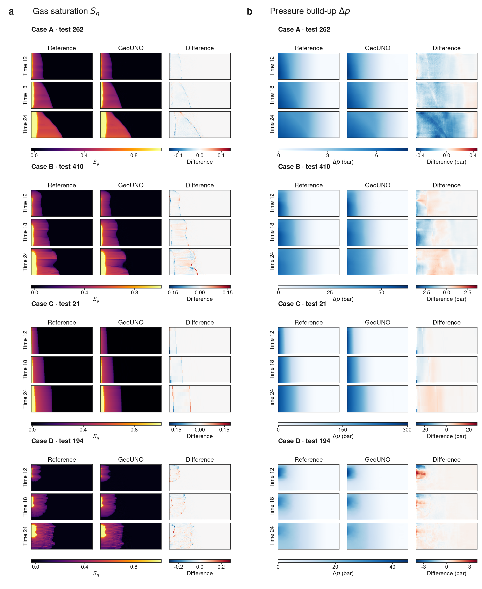

# GeoUNO: joint operator learning for geothermal forecasting and inference under uncertainty

[](LICENSE)
[](docs/DATA.md#licence)
[](pyproject.toml)
[](https://github.com/Yulongggggg/AVF_geothermal/actions/workflows/tests.yml)

GeoUNO jointly predicts transient temperature and pressure in geothermal reservoirs. Its differentiable
operator connects ensemble forecasting, permeability inference and monitoring design.

> Yulong Liu, Jonah Botvinick-Greenhouse, Yunan Yang and Chloé Arson.
> *Joint operator learning for geothermal forecasting and inference under uncertainty.* Manuscript, 2026.

The 15 October 2026 final model uses **3,520,755 parameters**, 1,024 fixed training-fitted POD functions and
64 learned functions per field. Three independent seeds achieve **0.362 ± 0.002 K** and **0.428 ± 0.002 MPa**
paired field RMSE over 618 test scenarios and eleven times. One realization's joint trajectory takes **0.015 s**
on the measured GPU setup. Across 24 reservoirs, ES-MDA reduces pressure and temperature field errors by
**97% and 48%** relative to prior forecasts; guided nine-location multiwell placement reduces near-producer
error by **37%** relative to space-filling placement.


The application checkpoint is the seed-20260915 member of the three-seed Table 1 comparison:
`f39894ff83e04f47b2a9098f0e387540e1390cf12b9d7f8726dc815dffd16dbb`.
This release includes that model, updated observation layouts and calibration, 24 test reservoirs,
1,560 saved task/reference score records, and the paper's numerical Source Data. The 19 October update
includes NUTS forecasts and diagnostics for all 24 reservoirs (96 completed chains): 23 pass convergence
criteria; `test_16` remains included with its diagnostic flag. Mean NUTS permeability, temperature-field
and pressure-field RMSEs are **0.645 dec, 6.631 K and 0.474 MPa**. The downloadable raw-chain bundles
currently cover the original six reservoirs; the full-cohort scores and diagnostic summaries are bundled
in [Source Data](geouno/resources/source_data/final_model_20261015).

## Quick start

```bash
git clone https://github.com/Yulongggggg/AVF_geothermal.git
cd AVF_geothermal
python -m pip install -e ".[all]"
geouno paper-numbers                   # 175 saved-value checks, no model execution
geouno download                        # checkpoint, prior factor and reservoir cases
geouno verify                          # hashes and strict checkpoint loading; no prediction
```

Large final-model assets are on the [`artifacts-final-20261015`](https://github.com/Yulongggggg/AVF_geothermal/tree/artifacts-final-20261015)
Git LFS branch. Each asset has a URL and SHA-256 in
[`release_manifest.json`](geouno/resources/release_manifest.json).
For a local asset copy, use `geouno download --from-dir /path/to/assets`.
While the repository is private, authenticated collaborators can obtain assets with SSH:

```bash
git clone --branch artifacts-final-20261015 --single-branch git@github.com:Yulongggggg/AVF_geothermal.git ../geouno-assets
cd ../geouno-assets
git lfs pull
cd ../AVF_geothermal
geouno download --from-dir ../geouno-assets
```

## Using the operator and inverse methods

```bash
geouno predict --case test_01 --times 10 --out prediction.npz
geouno run --config multiwell_opt17 --case test_01 --method esmda --threads 4
geouno run --config multiwell_opt17 --case test_01 --method map --threads 4
geouno prepare-cases --check --out runs/cases
geouno download --group nuts
```

Prediction and inverse commands run the model. The paper-number and artifact-verification commands operate
on saved results and model weights. See [reproduction instructions](docs/REPRODUCIBILITY.md) for batch tasks,
NUTS and training, and [data formats](docs/DATA.md) for units and array layouts.

| Component | Implementation |
|---|---|
| Final `resid64_p1` architecture | [`geouno/model/final.py`](geouno/model/final.py), [model description](docs/MODEL.md) |
| Main / temperature / joint training, 99 / 44 / 22 epochs | [`geouno/training`](geouno/training), [training instructions](docs/TRAINING.md) |
| Gaussian conditioning, MAP, ES-MDA, NUTS | [`geouno/inverse`](geouno/inverse) |
| 64 monitoring configurations and new optimized layouts | [`geouno/monitoring`](geouno/monitoring) |
| Tables and abstract numbers | [`geouno/paper.py`](geouno/paper.py), [Source Data](geouno/resources/source_data/final_model_20261015) |
| Exact original final-model source and implementation notes | [`provenance`](provenance), [source map](docs/PROVENANCE.md) |

The common 99-epoch appendix comparison currently contains completed DeepONet and U-Net results.
FNO, U-FNO, ResNet and GeoUNO rows use dashes while their remaining runs finish, matching the manuscript.

## CO₂ storage transfer

Retraining the same two-field design on the public U-FNO benchmark gives relative saturation and
normalized-pressure errors of **0.063** and **0.042** with 4,096 POD functions, below all five baselines.
Pressure normalization is `z_p = (Δp − 4.17294 bar) / 18.77282 bar`; physical pressure RMSE is reported separately.
The gallery shows saved predictions for four test cases and three times.



## Development and citation

```bash
python -m pip install -e ".[all,dev]"
ruff check .
pytest -q -m "not slow and not release and not model_execution"
```

Final-release validation uses saved numerical records, strict state loading, source checks and unit tests.
No training or prediction experiment was rerun to prepare this update. Earlier validation reports are dated in
[`docs/REVIEW_20261007.md`](docs/REVIEW_20261007.md).

Code is MIT licensed, with component-specific licences listed in
[THIRD_PARTY.md](THIRD_PARTY.md). Weights and data are CC BY 4.0.
Please cite the manuscript; bibliographic metadata are in [CITATION.cff](CITATION.cff).
