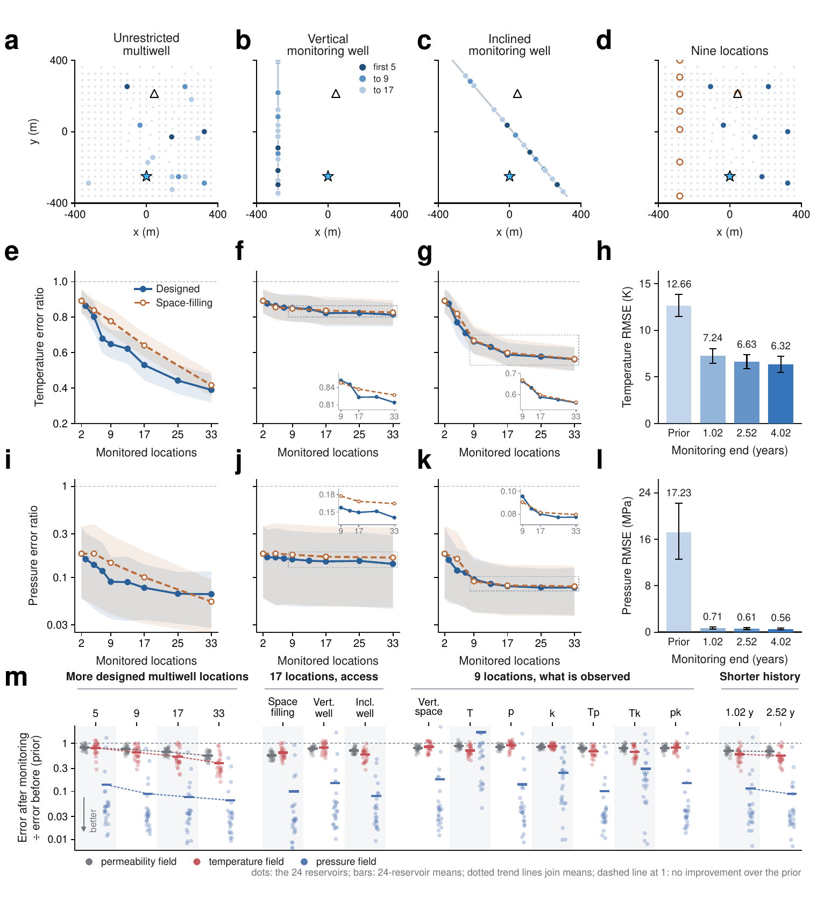

# Reproducing the paper

All commands assume `pip install -e ".[all]"` and `geouno download` (add `--group nuts` / `--group prior` where
noted). Times refer to the hardware stated in the paper unless marked otherwise.

## 1. Numbers in the tables (seconds)

```bash
geouno paper-numbers
```

Recomputes Table 1, Table 2 (both cohorts, including NUTS), Supplementary Table 1 and the abstract numbers from
`reference/source_data` and checks all 80 printed values. Expected: `{"checked": 80, "mismatches": 0}`.

## 2. Registered inference tasks

The study registered 1,128 inference tasks before inference: for each of 24 test reservoirs, 45 monitoring
configurations (validation-designed budgets of 2-33 locations in three access geometries: 25 configurations;
space-filling controls with 5, 9, 17 and 33 locations: 12; six observation-channel variants; two shorter durations),
four noise variants on the first six reservoirs, and three-start MAP for the 17-location multiwell configuration. Prior and statically conditioned
reference ensembles accompany each reservoir.

```bash
geouno run --config multiwell_opt17 --case test_01 --method esmda --threads 4   # one task
python scripts/run_all_tasks.py --out runs/paper --threads 4 --shard 0/8        # all tasks, resumable
python scripts/run_all_tasks.py --out runs/paper --summary                      # agreement with the paper runs
```

| Method | Seed | Settings |
|---|---|---|
| ES-MDA | `observation_seed + 19000` | 256 members, 8 updates, `alpha_i = 8`, all singular values, no localization |
| static-only (`multiwell_opt9_k`) | `observation_seed + 19000` | the ES-MDA initial ensemble, analytically conditioned |
| MAP | `observation_seed + 29000` | starts: origin + 2 normal draws; L-BFGS-B `maxiter=1000, maxfun=20000, maxls=40, gtol=1e-4, ftol=1e-10, maxcor=10` |
| prior / static_prior | `81071` | 256 draws; static_prior conditions on the 17 local permeability values |
| NUTS (`test_01`-`test_06`) | `observation_seed + 19000 + chain` | 4 chains, 512 warm-up + 1,024 draws, target acceptance 0.9, max tree depth 7 |

`observation_seed = 610000 + i` for `test_{i+1:02d}`. Likelihood: dynamic readings at stored times 0-6 (through
4.02 years), noise 0.5 K / 0.25 MPa plus the validation-fitted surrogate-error covariance; static readings with
0.1 dec noise; forecasts at 10.01 years. The paper ran ES-MDA and MAP on four CPU threads (10.2 and 10.4 min per
reservoir on average) and NUTS on one NVIDIA RTX A4000 (14.55 h per reservoir for four sequential chains).



*Paper Fig. 6: candidate geometries and designed versus space-filling layouts (a-d), error ratios versus number of
locations (e-g, i-k), monitoring duration (h, l) and observation types (m). Values come from the tasks above.*

### Expected agreement

`geouno run` and `scripts/run_all_tasks.py --summary` report relative differences of the manuscript metrics against
`reference/paper_task_scores.json`. The network runs in FP32, and CPU round-off depends on the processor and the
number of threads; ES-MDA and MAP iterate on the network outputs and therefore amplify round-off slightly. Agreement
to about 1e-4 is expected for ensemble methods and about 1 % for MAP point estimates (see section 5); bitwise
agreement is not expected across processors.

## 3. NUTS

```bash
geouno download --group nuts
geouno nuts-verify            # recompute R-hat/ESS from all 4 x 1,024 draws and rescore 256 balanced draws
geouno nuts-chain --case test_01 --chain 0 --device cuda:0 --out runs/nuts   # a new chain (hours)
geouno nuts-merge --case test_01 --dir runs/nuts
```

All six reservoirs meet the registered gate (max R-hat 1.022, min bulk ESS 306 for `test_04`, no divergences). Every
retained transition reached the depth-7 cap. A strict cross-device smoke test of the frozen bundle failed only its
FP32 tolerance, which is documented in `nuts/DEVIATION_smoke_20261001.md`. The other 18 reservoirs (72 chains) are
being sampled and are not part of this release.

## 4. Inverse prior, monitoring inputs and training

```bash
geouno download --group prior && geouno refit-prior --out runs/prior    # marginal SD 0.976 dec
geouno prepare-cases --check --out runs/cases                           # 49 configurations x 25 reservoirs
```

Monitoring placement was optimized on four validation reservoirs; the released `design.json` freezes the result.
Re-deriving it needs the three other validation reservoirs from the FE data release. Training and Table 1 evaluation
need the FE corpus ([TRAINING.md](TRAINING.md)).

## 5. Verification of this release

Measured on 5 October 2026 for this release (paper runs: cluster CPU, 4 threads; reruns: one NVIDIA RTX A4000
shared with other jobs, or the CPU where stated). Raw logs are not part of the repository; every check can be
repeated with the commands shown.

**Equivalence with the archived code** (`provenance/verify_equivalence.py`, CPU, 2 threads): 53 of 53 checks
bitwise identical - model outputs and off-grid queries; cached basis; posterior whitening, static conditioning,
permeability maps, predictions, value and gradient for three reservoirs; forecast scores and arrays; conditioning
primitives; scores; ES-MDA, MAP and NUTS against the original algorithm functions; monitoring geometries, noise,
masks, candidate bank, the 49 configurations and the design selection; training objective, validation metrics,
learning-rate schedule, parameter groups, data loading and epoch traversal. Recomputed monitoring candidates equal
the frozen protocol in 83 of 84 geometries and differ by at most 2.8e-14 m in the remaining one (platform `hypot`);
the frozen points are packaged and used.

**Released inputs:** all 25 reservoir case files regenerated by `geouno prepare-cases --check` are array-identical
to the paper's files; the refitted inverse prior has marginal SD 0.9759736257386048 dec (paper:
0.9759736257386044) and factor entries within 7.5e-9 of the released factor; `geouno verify` reproduces the
archived pilot posterior value and gradient to a relative difference of 2.3e-6.

**Paper tasks rerun from scratch** (`geouno run`, GPU). Field RMSE at 10.01 years, rerun / paper, and the largest
relative difference over all manuscript metrics of the task:

| Task | Temperature (K) | Pressure (MPa) | log10 k (dec) | Max rel. diff. |
|---|---|---|---|---|
| `multiwell_opt17/test_01/esmda` | 5.9972 / 5.9973 | 1.3582 / 1.3582 | 0.8310 / 0.8310 | 5.7e-05 |
| `vertical_opt9/test_02/esmda` | 6.3800 / 6.3800 | 0.7918 / 0.7918 | 0.7625 / 0.7625 | 1.6e-05 |
| `inclined_space17/test_05/esmda` | 6.2932 / 6.2932 | 0.2740 / 0.2740 | 0.7252 / 0.7252 | 2.2e-05 |
| `multiwell_opt9_Tk_noise2/test_03/esmda` | 12.7457 / 12.7457 | 9.5591 / 9.5591 | 0.5971 / 0.5971 | 9.3e-06 |
| `multiwell_opt9_k/test_01/static` | 13.4108 / 13.4108 | 21.7313 / 21.7313 | 0.9493 / 0.9493 | 2.6e-06 |
| `prior/test_01` | 15.1403 / 15.1403 | 32.7478 / 32.7478 | 1.0948 / 1.0948 | 2.4e-06 |
| `static_prior/test_01` | 11.5337 / 11.5337 | 21.2783 / 21.2783 | 0.7799 / 0.7799 | 1.0e-06 |
| `multiwell_opt17/test_01/map` | 5.7706 / 5.8063 | 1.5183 / 1.5338 | 0.7853 / 0.7864 | 1.0e-02 |

ES-MDA, static-only and reference ensembles agree to round-off. For MAP, all three L-BFGS-B starts converge in
both runs to posterior objectives between 150.613 and 150.618; round-off decides which of these nearly equal
optima is selected (paper: start 2, J = 150.6147; rerun: start 1, J = 150.6130), which moves the point estimate
and its field errors by up to 1 %. Treat MAP point estimates as reproducible to about 1 %, and the objective to
five significant digits.

**NUTS** (`geouno nuts-verify`): for all six reservoirs, R-hat, bulk and tail ESS and divergences recomputed from
the 4 x 1,024 released draws, and the scores of the 256 balanced forecast members, equal the archived values
exactly (max R-hat 1.0220 and min bulk ESS 306 for `test_04`; every case passes the gate).

**Paper numbers:** `geouno paper-numbers` reproduces all 80 printed values. The 8,184 per-reservoir values of the
monitoring Source Data agree with `reference/paper_task_scores.json` to 1e-7 relative (FP64 rescoring in the
audit) and the NUTS Source Data to 3e-8.

**Package:** all 36 unit and release tests and the three-epoch training smoke run pass. A fresh clone installed
from GitHub, with the core artifacts downloaded from the release, passes the same tests (the NUTS release test is
skipped without the `nuts` group), `geouno verify` and `geouno paper-numbers`; continuous integration runs the
31 tests that need no artifacts.

## 6. Limitations

* Synthetic two-dimensional reservoir sections; no field validation; posterior members are not re-simulated with FE.
* The test set was inspected during model development; 141 of 249 test fracture-image identifiers also occur in
  training, so the benchmark measures new characterizations and operating configurations rather than unseen geology.
* GeoUNO and the baselines have different training budgets and objectives.
* NUTS transitions saturate the maximum tree depth; inference costs of MAP/ES-MDA (CPU) and NUTS (GPU) use different
  resources.
* The FE solver build and part of the upstream DFN/FE lineage are not fully recorded (see `data_generation/`).
